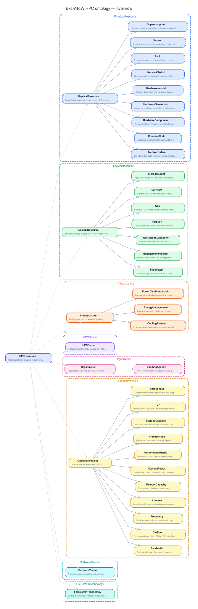
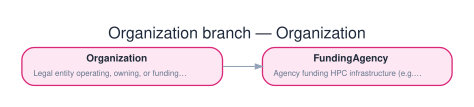
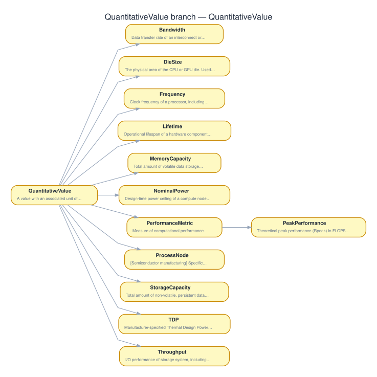
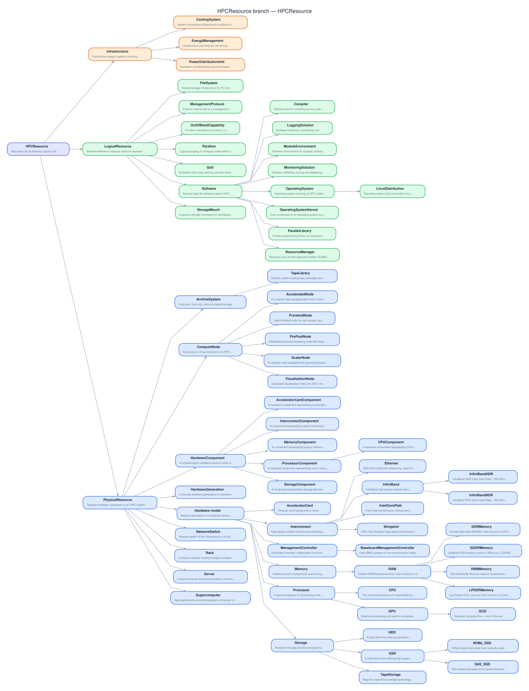
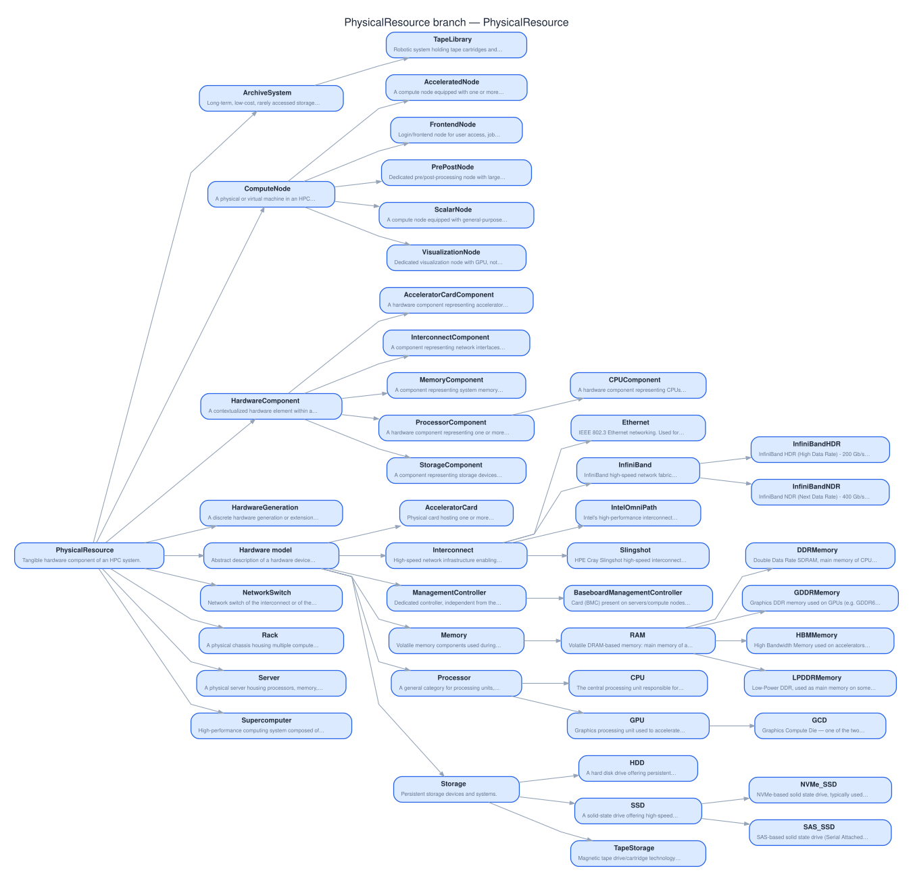
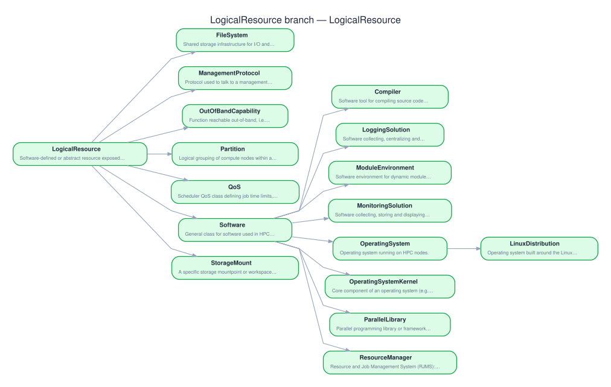
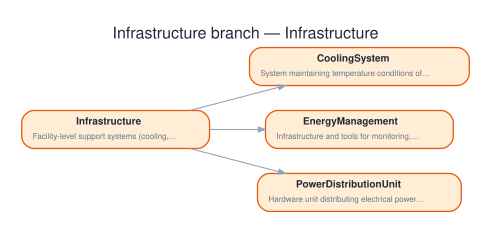
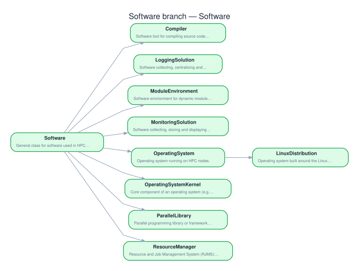
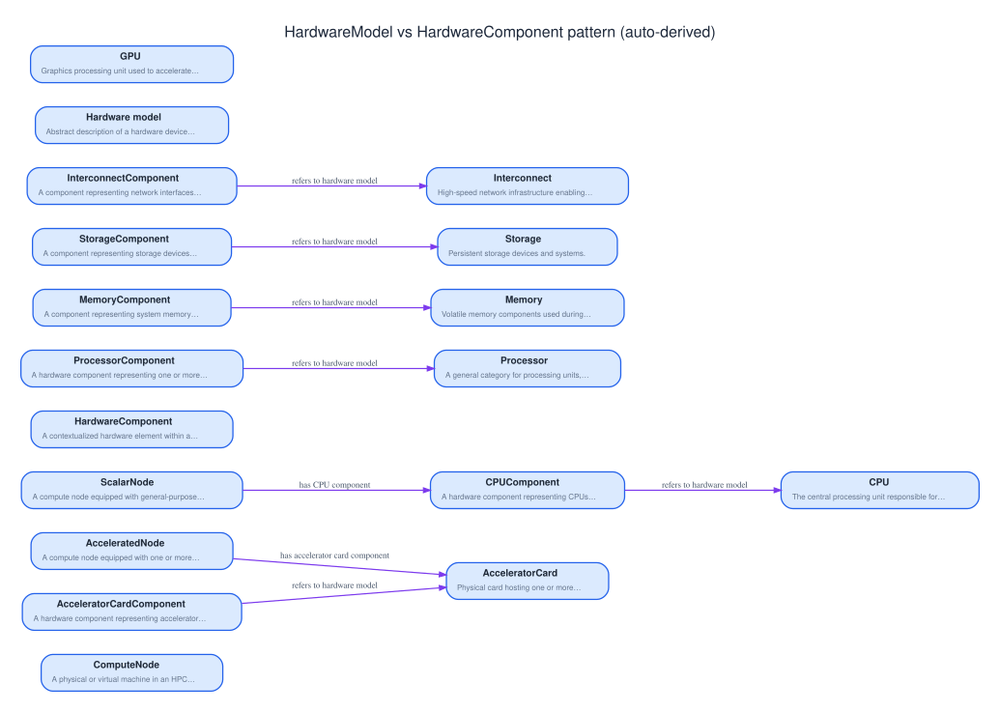
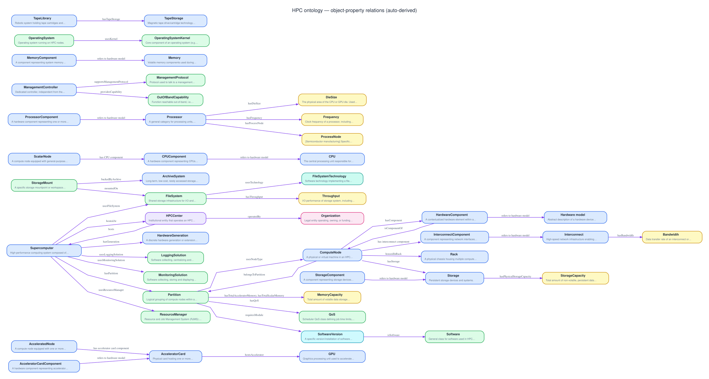

# HPC Resource Ontology 


| Resource | Link |
|---|---|
| Full ontology (TTL) | https://w3id.org/Exa-AToW/hpc |
| Core module (TTL) | https://w3id.org/Exa-AToW/hpc/hpc-core.ttl |
| Knowledge Graph viewer  | https://cnherrera.github.io/Exa-AToW_onto/tools/onto_visualization/onto-viewer.html |
| Widoco documentation | https://cnherrera.github.io/Exa-AToW_onto/hpc_ontology/index.html |
| Diagram sources (DOT) | [`resources/`](resources/) |

---

## Overview

The **HPC Resource Ontology** is an OWL 2 DL knowledge representation designed to formally describe the hardware, software, storage infrastructure, and organizational structure of High-Performance Computing (HPC) centers. It was developed within the Exa-AToW project as the semantic backbone for describing and comparing the French national supercomputing ecosystem.

Once instantiated with real system data, it enables answering structured SPARQL queries such as:

- Which partitions provide access to NVIDIA H100 or AMD MI250X GPUs?
- Which systems use Slurm? Which compilers are available per partition?
- What storage mounts are available to compute jobs?
- How does Adastra's AMD ROCm stack differ from Jean Zay's CUDA-based environment?

By encoding these facts as machine-readable RDF triples, the ontology supports interoperability, automated documentation, and integration with other semantic resources such as the PIE environmental impact ontology.

**Namespace**

```turtle
@prefix :     <https://w3id.org/Exa-AToW/hpc#> .          # classes & properties
```

---

## Module structure

The ontology is published as **two modules sharing one namespace**:

| Module | IRI | Version | Scope |
|---|---|---|---|
| [`hpc-core.ttl`](https://w3id.org/Exa-AToW/hpc/hpc-core.ttl) | `https://w3id.org/Exa-AToW/hpc/hpc-core.ttl` | `0.3.0` | Minimal vocabulary: supercomputer, partitions, racks, compute nodes, hardware models and installed components, storage, software, organizations |
| [`hpc.ttl`](https://w3id.org/Exa-AToW/hpc) | `https://w3id.org/Exa-AToW/hpc/hpc.ttl` | `0.3.0` | Imports the core and adds infrastructure (cooling, PDU, energy management), interconnects, management controllers, software stack, quantitative values |

`hpc.ttl` declares `owl:imports <https://w3id.org/Exa-AToW/hpc/hpc-core.ttl>`; the core is loaded transitively. Consumers that only need the minimal vocabulary can import the core alone.


---

## Architecture

The ontology is organized around **disjoint top-level branches**:

<br>

<p align="center"></p>

| Branch | Definition | Key classes |
|---|---|---|
| **HPC Center** | Institutional entity that operates and hosts one or more supercomputers. | `HPCCenter` |
| **Organization** | Institutions operating or funding centers. | `Organization`, `FundingAgency` |
| **Quantitative Value** | Typed numeric values with an associated unit of measurement. | `DieSize`, `MemoryCapacity`, `TDP`, `Lifetime`, `Bandwidth`, `Frequency`, … |
| **HPC Resource** | All resources involved in high-performance computing. | `Infrastructure`, `LogicalResource`, `PhysicalResource` |

### HPC Center

<p align="center"></p>

### Organization

<p align="center"></p>

### Quantitative Value

<p align="center"></p>

### The HPC Resource branch

<p align="center"></p>

| Sub-branch | Description | Diagram |
|---|---|---|
| **PhysicalResource** | All tangible hardware: `Supercomputer`, `ComputeNode`, `HardwareModel`, `HardwareComponent`, … |  |
| **LogicalResource** | Software-defined / scheduler-visible resources: `Partition`, `QoS`, `FileSystem`, `StorageMount`, `Software`, … |  |
| **Infrastructure** | Facility-level support systems: `CoolingSystem`, `EnergyManagement`, `PowerDistributionUnit` |  |
| **Software** | Compilers, OS, resource managers, monitoring, logging, … |  |

---

### Core design pattern: HardwareModel vs HardwareComponent

A central design decision separates **abstract hardware specifications** (`HardwareModel`) from **contextualized instantiations** (`HardwareComponent`):

- **HardwareModel** — the component model/type (e.g. NVIDIA H100, Intel Xeon Platinum). A conceptual class describing general specifications.
- **HardwareComponent** — the actual physical instance of a model installed in a specific system.

Benefits:

- State that a node has *N* instances of the same component model.
- Provenance chains: track which models are present, in which nodes, and in what quantity.
- Targeted queries: "how many instances of the H100 model are present?" vs "which GPU models are used?".
- Scalability: easier management of configuration variants.

<p align="center"></p>

```
ComputeNode
  ├─ hasCPUComponent ────────────► CPUComponent        ── refersToModel ──► CPU   (e.g. AMD EPYC 9654)
  ├─ hasAcceleratorCardComponent ► AcceleratorCardComp ── refersToModel ──► AcceleratorCard (e.g. MI250X)
  ├─ hasMemoryComponent ─────────► MemoryComponent     ── refersToModel ──► Memory / HBMMemory
  ├─ hasInterconnectComponent ───► InterconnectComp    ── refersToModel ──► Interconnect (e.g. Slingshot)
  └─ hasStorageComponent ────────► StorageComponent    ── refersToModel ──► SSD / HDD
```

Example chain:

> HPC Center → *hosts* → Supercomputer → *composed of* → [Partition, ComputeNode] → *hasComponent* → CPUComponent / AcceleratorCardComponent → *refersToModel* → CPU / AcceleratorCard (→ GPU)

### Object-property relations

The map below is derived directly from the ontology (rdfs:domain/rdfs:range **and** OWL restrictions):

<p align="center"></p>

### Energy calculation path

The ontology was designed to feed energy microservices (PUE estimation, carbon footprint):

```
Partition
  └─ usesNodeType ──► ComputeNode
                         ├─ hasNominalPower ──► NominalPower  (e.g. 945 W / scalar node)
                         ├─ hasCPUComponent
                         │    └─ refersToModel ──► CPU ──► hasTDP ──► TDP  (e.g. 360 W)
                         └─ hasAcceleratorCardComponent
                              └─ refersToModel ──► AcceleratorCard ──► hasTDP ──► TDP  (e.g. 560 W)
```

- `NominalPower` (on `ComputeNode`) captures the full node power budget including DRAM and board overhead.
- `TDP` (on `Processor` and `AcceleratorCard`) captures the manufacturer-specified per-component thermal design power.

---

## Instances (ABox)

All instance files share the namespace `https://w3id.org/Exa-AToW/hpc/instances#` and load together as **one graph**.

| File | Contents |
|---|---|
| `hpc-centers.ttl` | Bureaucratic directory of French national HPC centers + their organizations/funders |
| `hpc-instances.ttl` | Combined ABox for the three national systems (CINES / IDRIS / TGCC) |
| `hpc-instances-cines.ttl` | Full ABox for **CINES / Adastra** |
| `hpc-instances-idris.ttl` | Full ABox for **IDRIS / Jean Zay** |
| `hpc-instances-tgcc.ttl` | Full ABox for **TGCC / Irène + Topaze** |

Because the instance namespace is shared, the same real-world entity (a center, an organization, a hardware model, a scheduler, …) is referenced by the **same IRI** across files — so loading several ABoxes yields a single, de-duplicated knowledge graph.

---

## Knowledge Graph viewer

The onto viewer (`tools/onto_visualization/onto-viewer.html`) loads several ontologies and ABoxes at the same time:

- **TBox buttons** — `Workflow`, `HPC`, `PIE` (three class/property schemas, all pre-loaded on start).
- **ABox buttons** — `HPC Centers`, `HPC Instances`, `Workflow Instances`, plus an `All ABoxes` master toggle.
- The buttons are **non-disjoint**: toggling one never deactivates another. The graph is rebuilt from the **union** of all active sources.
- **Shared-instance detection**: when the same instance IRI appears in more than one active source it becomes a single node, highlighted with a gold double border, listed under *“Shared instance — found in N sources”* in the Node Details panel, and counted in the `★ shared` stat chip.
- **Unified search** over the whole merged graph (TBox + all ABoxes), with a clickable results list (instances ranked first) and attribute matching.


Mount the whole graph with one `owl:imports` declaration:

```turtle
<https://example.org/my-kg> a owl:Ontology ;
    owl:imports <https://w3id.org/Exa-AToW/hpc> ,
                <https://w3id.org/Exa-AToW/hpc/instances> .
```

---

## Validation

SHACL shapes to be defined. All TTL files parse as Turtle and load together as one graph (verified with `rdflib` and the multi-source viewer).

---

## License

© Exa-AToW team. See project repository for license details.
